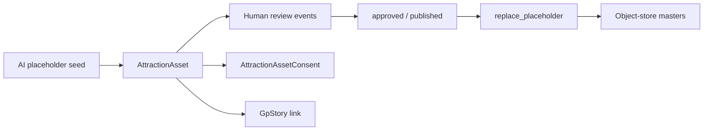

# GP Attraction Asset Library — Implementation

Approved source: [`docs/proposals/gp-attraction-asset-library/`](./proposals/gp-attraction-asset-library/)

## Goals

Clinic-scoped registry for attraction media with **taxonomy**, **lifecycle states**, **human review cycle**, **consent linkage**, and **story linkage**. Supports **images, videos, transcripts, quotes**. AI placeholders ship first; `assetId` stays stable when masters replace placeholders via `replaceablePath` / `replacePlaceholderAsset`.

## Architecture



## Database (Prisma)

| Model | Purpose |
| --- | --- |
| `AttractionAsset` | Registry row: kind, taxonomy, rights, storage, cadence, story/consent FKs |
| `AttractionAssetConsent` | Versioned media consent for identifiable people |
| `AttractionAssetReviewEvent` | Immutable human lifecycle decisions |

Kinds: `image`, `video`, `transcript`, `quote`, `testimonial_ref`, `consent_document`, `other`.

Statuses: `captured` → `catalogued` → `in_review` → `approved` → `published` (+ `review_due`, `retired`, `withdrawn`, `purged`).

## Storage architecture

| Folder key | Path |
| --- | --- |
| Public AI placeholders | `/assets/practice-experience/*` (current) and `assets/attraction/placeholders` |
| Image masters | `attraction-assets/images/masters` |
| Image derivatives | `attraction-assets/images/derivatives` |
| Video masters / delivers | `attraction-assets/video/{masters,delivers}` |
| Transcripts / quotes | `attraction-assets/transcripts`, `attraction-assets/quotes` |
| Quarantine / archive / consent | `attraction-assets/_quarantine`, `_archive`, `_consent` |

Filename rule: `{ASSET_ID}__{kebab-scene}__{yyyy-mm}.{ext}`.

## Services

| Module | Responsibility |
| --- | --- |
| `asset-library/taxonomy.ts` | Scenes, surfaces, modules, personas, AI policies |
| `asset-library/storage.ts` | Folder map, filename, derivatives, master keys |
| `asset-library/lifecycle.ts` | Transitions, cadence, publish blockers |
| `asset-library/registry.ts` | List/get/upsert/replace placeholder |
| `asset-library/reviews.ts` | Human-only review events |
| `asset-library/consent.ts` | Consent create/sign + story/consent link |
| `asset-library/seed-placeholders.ts` | PE image + video/transcript/quote AI seed |

## Admin UI

```
/admin/asset-library                 Registry + seed
/admin/asset-library/[id]            Detail + review + consent
/admin/asset-library/architecture    Storage / taxonomy / lifecycle map
```

APIs under `/api/admin/attraction/assets` (+ `/[id]`, `/reviews`, `/consent`).

## Review workflow

Human decisions (clinical sign-off): `submit_for_review`, `request_changes`, `approve`, `publish`, `mark_review_due`, `retire`, `withdraw`, `purge`, `replace_placeholder`.

Publish gates: alt/caption/quote completeness; consent required for identifiable rights classes.

## Seed (AI placeholders)

Seven PE stills (`PE-*`), `VID-TD-01`, `TRN-TD-01`, `QT-PE-TD-01`. Paths point at existing Practice Experience public JPEGs; `replaceablePath` holds future master keys.

## Phase boundaries

- No production object-store upload yet — registry + public placeholders only.
- Named people still need Story Capture / signed consent before non-placeholder publish.
- Attraction CMS Phase 1 production publish remains blocked.
