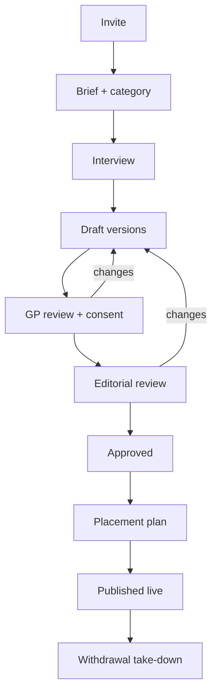

# GP Story Capture System — Implementation Plan

Approved source: [`docs/proposals/gp-story-capture-system/`](../docs/proposals/gp-story-capture-system/)

## Goals

Collect, consent, review, place, and withdraw GP practice-experience stories with **human gates only**, **default-deny reuse**, **versioned consent**, and **placement tracking**.

## Architecture



## Database (Prisma)

| Model | Purpose |
| --- | --- |
| `GpStory` | Inventory root |
| `GpStoryCategoryAssignment` | Primary/secondary categories |
| `GpStoryVersion` | Immutable draft lineage per format |
| `GpStoryConsent` | Versioned consent records |
| `GpStoryReusePolicy` | Per-channel allow/deny (**default deny**) |
| `GpStoryPlacement` | Surface placement + live/take-down |
| `GpStoryReviewEvent` | Immutable human review log |
| `GpStorySourceAsset` | Interview/consent source files |

## Services

| Module | Responsibility |
| --- | --- |
| `story-capture/stories.ts` | Create/list/update inventory; seed default-deny policies |
| `story-capture/versions.ts` | Create immutable versions |
| `story-capture/consent.ts` | Versioned consent; sign; supersede; withdraw |
| `story-capture/reuse.ts` | Evaluate channel allow; sync policies from consent |
| `story-capture/reviews.ts` | Human status advances |
| `story-capture/placements.ts` | Create/go-live/take-down; PE / Opportunities / Pack surfaces |
| `story-capture/withdrawal.ts` | SLA take-down workflow |

## Admin UI

```
/admin/story-capture                 Inventory dashboard
/admin/story-capture/new             Invite / create
/admin/story-capture/[id]            Workflow hub
/admin/story-capture/[id]/consent    Consent versions
/admin/story-capture/[id]/placements Placement management
/admin/story-capture/architecture    Structure note
```

## Integration surfaces

| Channel | Surface path | Product |
| --- | --- | --- |
| `practice_experience_web` | `about-us/practice-experience.html` | Practice Experience Hub |
| `gp_opportunities_rail` | `join-our-team.html#gp-opportunities` | GP Opportunities |
| `internal_proposal_pack` | `opportunity-pack:internal` | Opportunity Pack (non-public) |
| `join_our_team_quiet_quote` | `join-our-team.html#gp-voices` | Join Our Team quiet quote |
| `owned_social_og` | `social:og` | Owned social / OG |
| `video_embed` | `video:embed` | Video embed |

Attraction CMS: `AttractionDocument` kind `story` may set `storyCaptureRef = gp-story:{id}`.

## Admin UI structure (shipped)

| Route | Role |
| --- | --- |
| `/admin/story-capture` | Inventory + live PE/Opportunities/Pack counts |
| `/admin/story-capture/new` | Invite/create (seeds default-deny) |
| `/admin/story-capture/[id]` | Consent, versions, reviews, placements, withdraw |
| `/admin/story-capture/architecture` | Structure note |

Nav: **Content → Story Capture**

## API structure (shipped)

| Path | Actions |
| --- | --- |
| `POST /api/admin/story-capture/stories` | Create |
| `GET/PATCH .../stories/[id]` | Detail / fields |
| `POST .../consent` | share_summary · create_version · link_draft · sign |
| `POST .../versions` | Immutable draft versions |
| `POST .../reviews` | Human status advances |
| `POST .../placements` | create · go_live · take_down |
| `POST .../withdraw` | Full withdrawal + take-down |
| `GET .../integration` | Live quotes for PE / Opportunities / Pack |

## Migration

```bash
cd apps/web
npx prisma migrate deploy
npx prisma generate   # restart UAT/dev if Windows locks query engine DLL
```

Migration folder: `prisma/migrations/20261104140000_gp_story_capture/`

## Non-goals (this ship)

- Auto-publish from content intelligence
- Public HTML inject of live quotes (placement tracking + integration read-model only; public render later)
- Binary media storage pipeline
- Golden-master edits
